# Vinheria Agnello — loja virtual

[](https://github.com/KellyReisLee/vinheria-agnello-entrega-fiap/actions/workflows/ci.yml)

E-commerce da **Vinheria Agnello**, uma adega de vinhos. O cliente monta o carrinho, paga pelo Mercado Pago
(Pix, cartão ou boleto) e acompanha o pedido na área pessoal; a equipe gerencia vinhos, estoque, pedidos e
mensagens num painel administrativo.

**Site no ar:** <https://vinheria-agnello-entrega-fiap-1.onrender.com>
(plano gratuito do Render: a primeira visita depois de um tempo parado pode levar até 1 minuto para abrir).

---

## Funcionalidades

### Para o cliente
- **Catálogo** com busca, filtros (tipo, país, faixa de preço, só disponíveis), ordenação e paginação.
- **Busca no topo do site** com sugestões enquanto digita (atalho: tecla `/`).
- **Página do vinho** com ficha técnica, harmonização e vinhos relacionados.
- **Sommelier Virtual**: um quiz que indica vinhos de acordo com o gosto do cliente.
- **Calculadora de eventos**: estima quantas garrafas comprar para um jantar, festa ou coquetel e envia o
  orçamento por e-mail (para a loja e para o cliente).
- **Carrinho e checkout** com retirada na adega ou entrega, endereços guardados e preenchimento pelo CEP (ViaCEP).
- **Frete por região**, calculado pelo CEP, e **frete grátis a partir de R$ 500**.
- **Pagamento real pelo Mercado Pago** (Checkout Pro): Pix com 5% de desconto, cartão em até 6x e boleto.
  A confirmação chega automaticamente pelo webhook.
- **"Avise-me quando chegar"**: em vinhos esgotados, o cliente deixa o e-mail e recebe um aviso quando o
  estoque voltar.
- **Conta do cliente** (pessoa física ou jurídica): cadastro com ativação por e-mail, login, recuperação de senha,
  favoritos, endereços, histórico e cancelamento de pedidos, "comprar novamente", troca de senha e exclusão da conta.
- E-mails transacionais em HTML (boas-vindas, pedido recebido, pagamento confirmado, orçamento, aviso de estoque).
- Páginas institucionais: Sobre, Contato (com chat), Entregas e Trocas, Termos e Política de Privacidade (LGPD).
- Verificação de maioridade (venda de bebidas alcoólicas).

### Para a equipe (`/admin`)
- Painel inicial com pedidos para preparar, pagamentos pendentes, mensagens sem resposta e os últimos pedidos.
- Cadastro e edição de vinhos com upload de imagens, ajuste rápido de estoque e quantos clientes estão "à espera".
- Pedidos: mudança de situação com histórico (quem mudou e quando), dados do pagamento no Mercado Pago.
- Mensagens recebidas pelo Contato.

---

## Capturas de tela

<sub>Telas geradas a partir do código do projeto, com dados de exemplo.</sub>

| Página inicial | Catálogo com filtros |
|---|---|
| 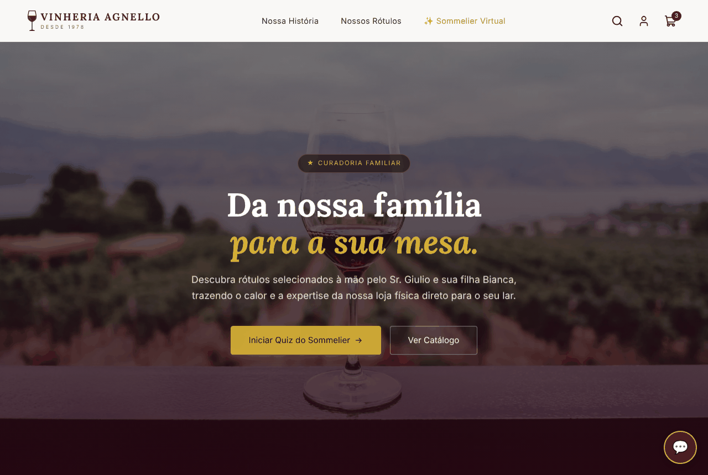 | 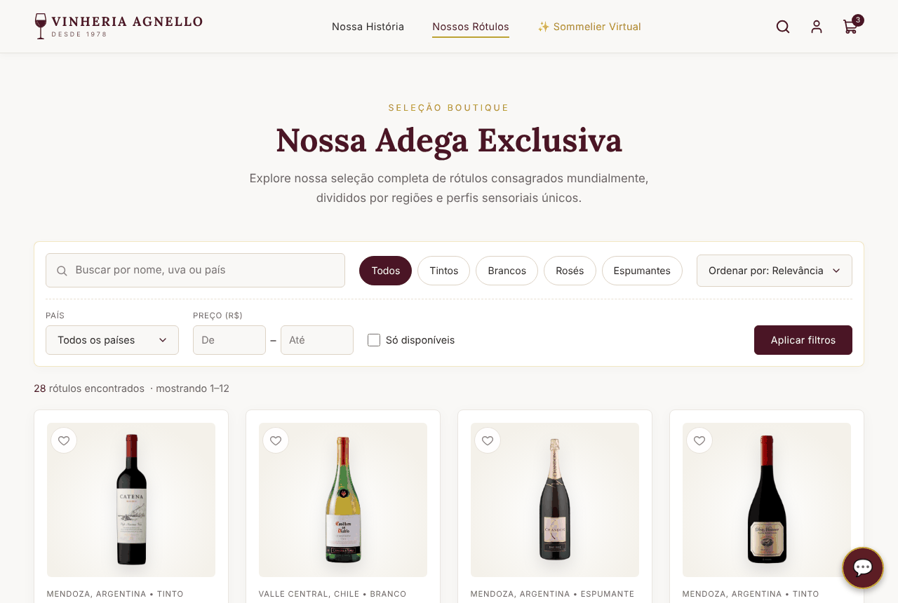 |
| **Página do vinho** | **Checkout com frete pelo CEP** |
| 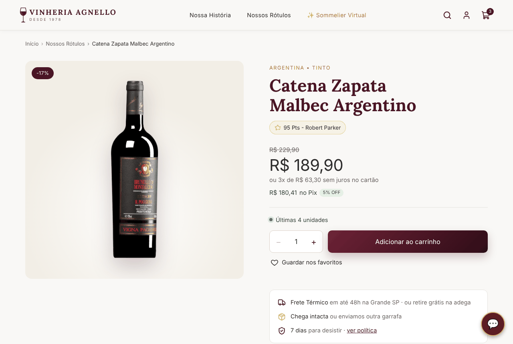 | 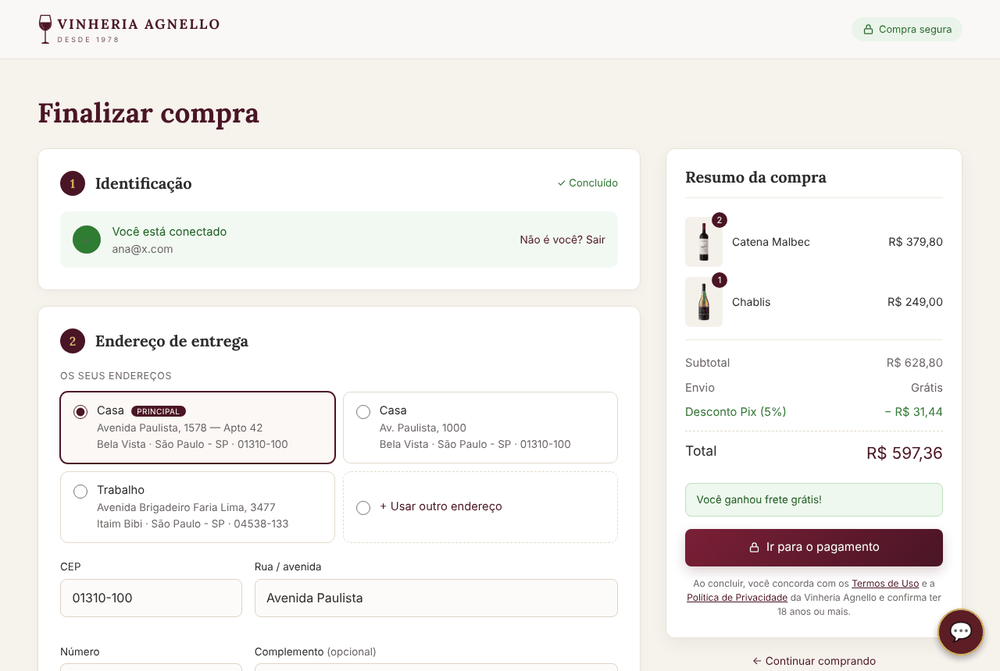 |
| **Área pessoal** | **Volta do Mercado Pago** |
| 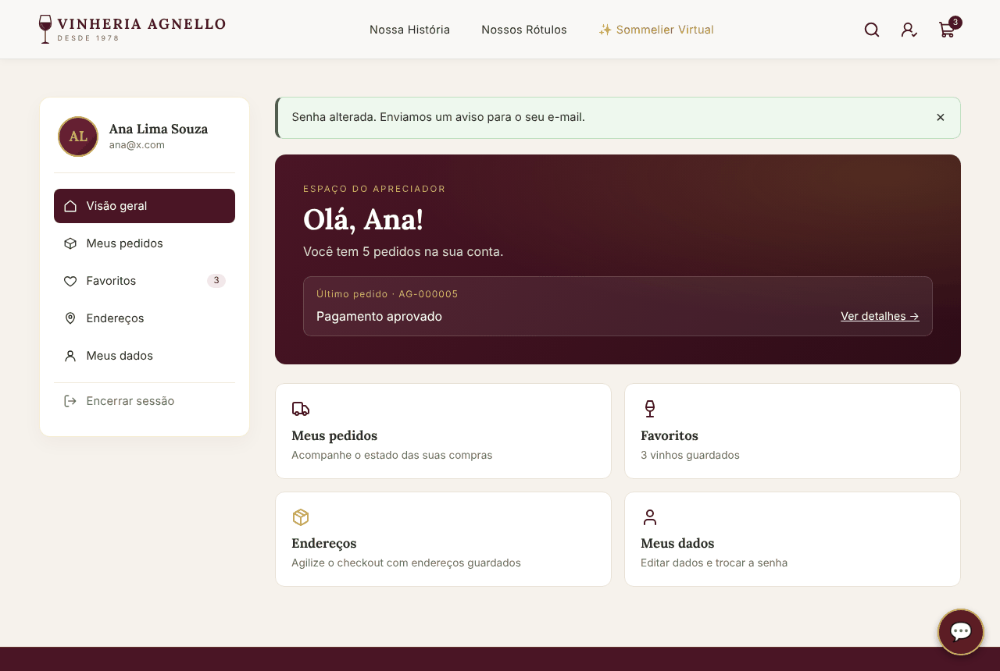 | 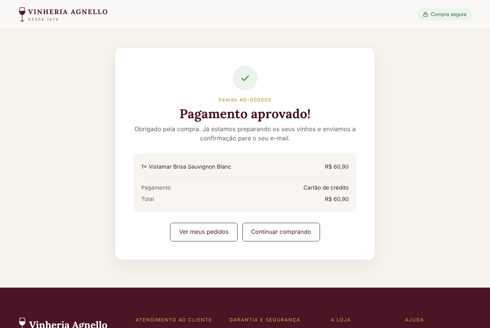 |
| **Painel: visão geral** | **Painel: pedido pago pelo Mercado Pago** |
| 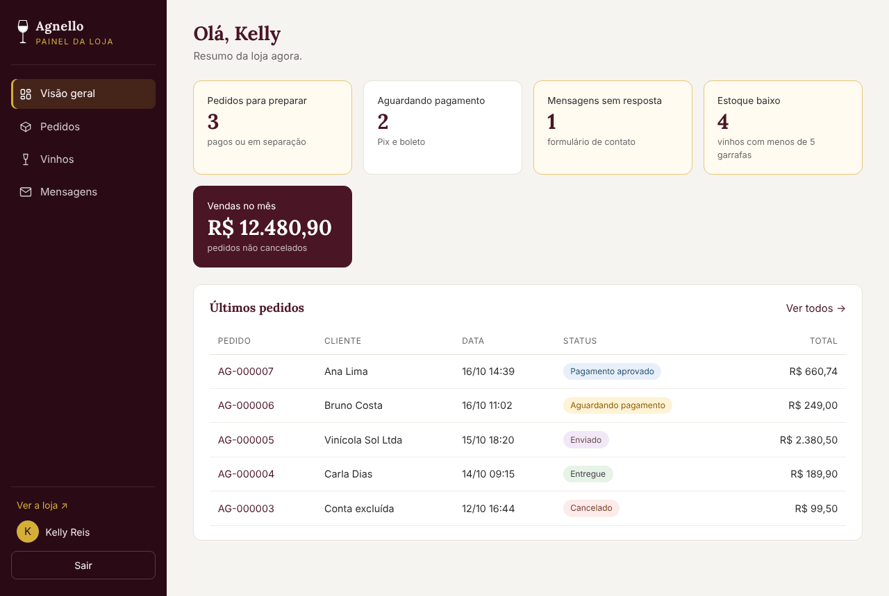 | 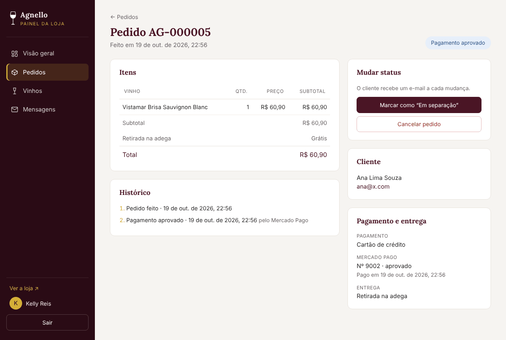 |
| **Painel: vinhos e estoque** | **Sommelier Virtual** |
| 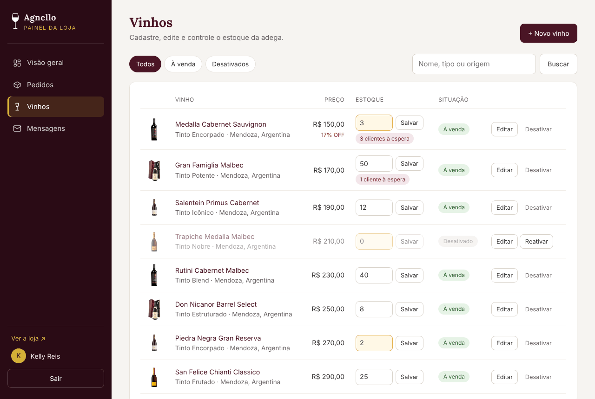 |  |

<p align="center">
  
  &nbsp;&nbsp;
  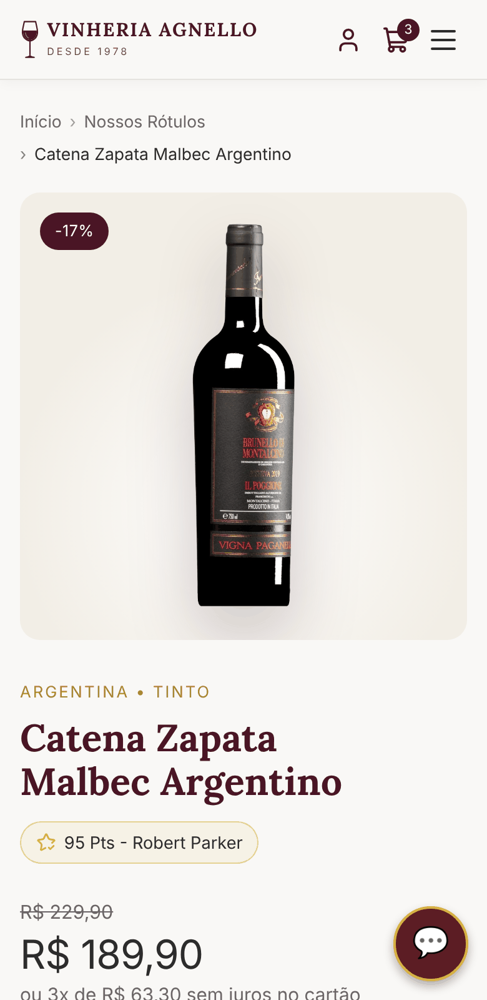
  <br><em>O site também se adapta ao celular.</em>
</p>

---

## Tecnologias

| Camada | Tecnologia |
|---|---|
| Linguagem | Java 17 |
| Web | Jakarta Servlet 6 + JSP/JSTL 3 (Tomcat 10.1) |
| Banco de dados | PostgreSQL (Neon), JDBC com `PreparedStatement` |
| Front-end | HTML, CSS e JavaScript puro (sem frameworks) |
| Pagamentos | Mercado Pago — Checkout Pro + webhook |
| E-mail | API da Brevo |
| Build e testes | Maven, JUnit 5 |
| Integração contínua | GitHub Actions (`.github/workflows/ci.yml`) |
| Hospedagem | Render (Docker) |

---

## Arquitetura

O projeto segue o padrão **MVC** em camadas:

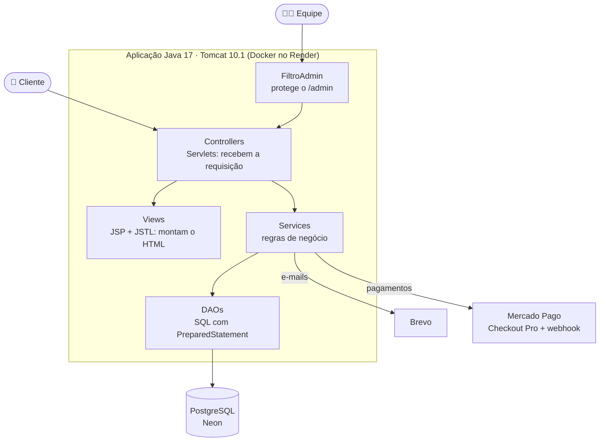

- **Controller** recebe a requisição, valida a sessão e o CSRF e escolhe a página (ou responde JSON).
- **Service** concentra as regras: preços recalculados no servidor, estoque, frete, descontos, pagamento.
- **DAO** faz o acesso ao banco, sempre com `PreparedStatement`.
- Formulários usam **Post/Redirect/Get**, com mensagens "flash" entre o POST e a página seguinte.

### Como funciona uma compra

O preço nunca vem do navegador: o servidor recalcula tudo, grava o pedido e só então cria a página de
pagamento. A confirmação é feita consultando a API do Mercado Pago, seja pelo webhook ou pela volta do cliente.

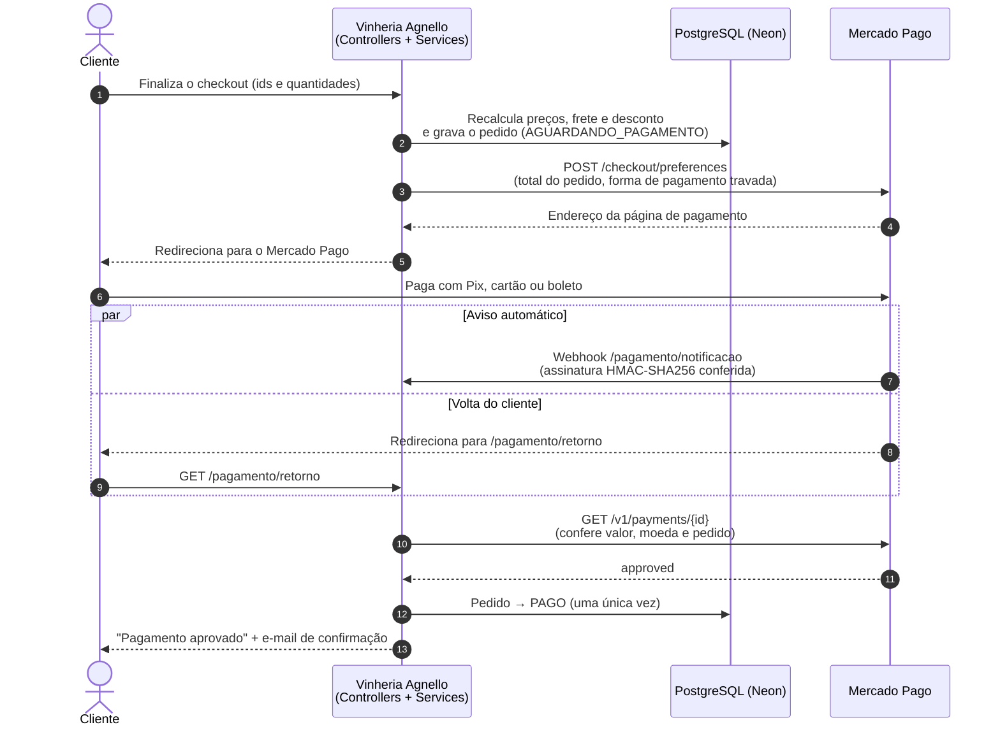

### Banco de dados

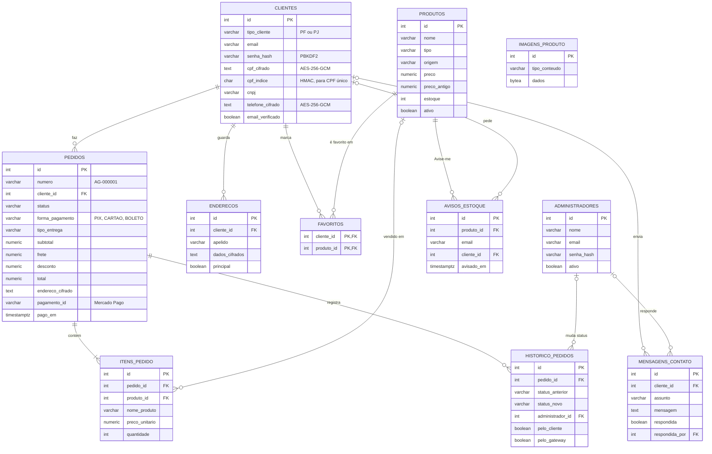

> Os diagramas também estão em `docs/diagramas/` (código Mermaid e imagem PNG, para usar em apresentações).

### Estrutura de pastas

```
├── .github/workflows/ci.yml        # testes automáticos a cada push
├── Dockerfile                      # build Maven + Tomcat 10.1 (usado pelo Render)
├── db/
│   ├── schema.sql                  # banco completo, para criar do zero
│   ├── migracoes/V2…V9__*.sql      # mudanças incrementais (rodar em ordem)
│   └── README.md                   # passo a passo de cada migração
├── pom.xml
└── src/
    ├── main/java/com/agnello/
    │   ├── controller/             # servlets do site (e controller/admin para o painel)
    │   ├── service/                # regras de negócio
    │   ├── dao/                    # acesso ao banco
    │   ├── model/                  # entidades (Produto, Pedido, ClientePF, ClientePJ…)
    │   ├── pagamento/              # integração com o Mercado Pago
    │   ├── seguranca/              # senhas, CSRF, cifra de dados, limite de tentativas
    │   ├── filtro/                 # filtro de acesso ao /admin
    │   ├── connection/             # conexão com o banco
    │   ├── migracao/               # utilitários (gerar chaves, criar administrador)
    │   ├── exception/
    │   └── util/
    ├── main/webapp/
    │   ├── WEB-INF/views/          # páginas JSP
    │   ├── css/  js/  assets/
    │   └── WEB-INF/web.xml
    └── test/java/                  # testes JUnit
```

---

## Como rodar localmente

### Pré-requisitos
- **Java 17** (JDK)
- **Eclipse IDE for Enterprise Java and Web Developers** (ou Maven 3.9 na linha de comando)
- **Apache Tomcat 10.1**
- Um banco **PostgreSQL** (o projeto usa o [Neon](https://neon.tech), que tem plano gratuito)

### 1. Banco de dados
No SQL Editor do Neon, rode `db/schema.sql` (cria todas as tabelas). Se o banco já existia, rode só as
migrações que faltam, em ordem, seguindo o `db/README.md`.

### 2. Variáveis de ambiente
Todas as senhas e chaves ficam **fora do código**, em variáveis de ambiente. No Eclipse: aba **Servers** →
duplo clique no Tomcat → **Open launch configuration** → aba **Environment**.

| Variável | Obrigatória | Para quê |
|---|---|---|
| `NEON_DB_URL` | sim | Endereço JDBC do banco (`jdbc:postgresql://…/neondb?sslmode=require`) |
| `NEON_DB_USER` / `NEON_DB_PASSWORD` | sim | Usuário e senha do banco |
| `AGNELLO_CHAVE_DADOS` | sim | Chave AES-256 que cifra CPF, telefone e endereços |
| `AGNELLO_CHAVE_INDICE` | sim | Chave HMAC usada para encontrar CPF/CNPJ sem decifrar |
| `EMAIL_USER` / `EMAIL_PASSWORD` | para e-mails | Remetente e chave da API da Brevo |
| `EMAIL_CONTATO` | não | E-mail da loja que recebe contatos e orçamentos |
| `AGNELLO_URL_BASE` | recomendada | Endereço público do site (ex.: `https://….onrender.com`), usado nos links dos e-mails e no retorno do pagamento |
| `MP_ACCESS_TOKEN` | para pagamentos | Access Token do Mercado Pago (`TEST-…` para testes) |
| `MP_WEBHOOK_SECRET` | para pagamentos | Assinatura secreta do webhook do Mercado Pago |

As duas chaves `AGNELLO_CHAVE_*` são geradas uma vez com `com.agnello.migracao.GerarChaves`
(botão direito → **Run As → Java Application**). Guarde-as num gerenciador de senhas: sem a chave de dados,
os dados cifrados não podem ser recuperados.

### 3. Rodar
1. **File → Import → Maven → Existing Maven Projects** e escolha a pasta do projeto.
2. Botão direito no projeto → **Run As → Run on Server** → Tomcat 10.1.
3. Abra <http://localhost:8080/vinheria-agnello/>.

Para criar a primeira conta de administrador, rode `com.agnello.migracao.CriarAdministrador`
(veja o passo a passo no `db/README.md`) e entre em `/admin/login`.

---

## Testes

```bash
mvn test
```

Os testes unitários (JUnit 5) cobrem as regras principais: cálculo do pedido e do frete, descontos e parcelas,
validações de cadastro, pagamento e assinatura do webhook do Mercado Pago, orçamento de eventos, "Avise-me",
cifra de dados e senhas. Eles usam DAOs falsos, então **não precisam de banco nem de internet**.

O GitHub Actions roda `mvn verify` a cada push e em cada pull request; o selo no topo deste arquivo mostra o
resultado da última execução.

---

## Deploy (Render)

O `Dockerfile` compila o projeto com Maven e publica o `.war` como `ROOT` num Tomcat 10.1.
No Render: **New → Web Service** → este repositório → ambiente **Docker**, e cadastre as variáveis de ambiente
da tabela acima em **Environment**. Cada push na branch `main` gera um deploy novo.

> Antes de publicar uma versão que traz uma migração nova (`db/migracoes/V*.sql`), rode essa migração no Neon.

### Verificar a configuração: `/saude`

Abra `https://<seu-site>/saude` para ver, em segundos, se está tudo configurado. A página **nunca mostra
valores** (senhas, chaves, tokens), só se cada item está `ok`:

```json
{"status":"ok","chaves":"ok","migracaoV8":"ok","migracaoV9":"ok","chavesAbremOsDados":"ok",
 "banco":"ok","email":"ok","enderecoDoSite":"ok","mercadoPago":"ok","webhookMercadoPago":"ok"}
```

- `chavesAbremOsDados: "erro"` → as chaves `AGNELLO_CHAVE_*` do servidor são diferentes das usadas quando
  as contas foram criadas (login e recuperação de senha falham).
- `migracaoV9: "falta rodar no Neon"` → rode o arquivo da migração no SQL Editor do Neon.

No Render, use `/saude` em **Settings → Health Check Path**: assim uma versão nova só recebe visitantes
depois de estar pronta (evita o erro 502 durante o deploy).

---

## Segurança

- Senhas com **PBKDF2** (salt individual); bloqueio temporário após várias tentativas erradas.
- CPF, telefone e endereços **cifrados com AES-256-GCM**; as chaves ficam só em variáveis de ambiente.
- Proteção contra **CSRF** em todos os formulários e chamadas `fetch`.
- Consultas sempre com `PreparedStatement` (contra SQL injection) e saída com `<c:out>` (contra XSS).
- Preços, frete e descontos são **recalculados no servidor**; o navegador só envia os ids e as quantidades.
- O pagamento é sempre **conferido na API do Mercado Pago** (valor, moeda e pedido) e o webhook tem a
  assinatura verificada (HMAC-SHA256). Os dados do cartão nunca passam pelo nosso servidor.
- Campos "armadilha" e limite de envios contra robôs nos formulários públicos.
- Painel `/admin` separado das contas de clientes, com filtro de acesso e cabeçalhos de segurança próprios.
